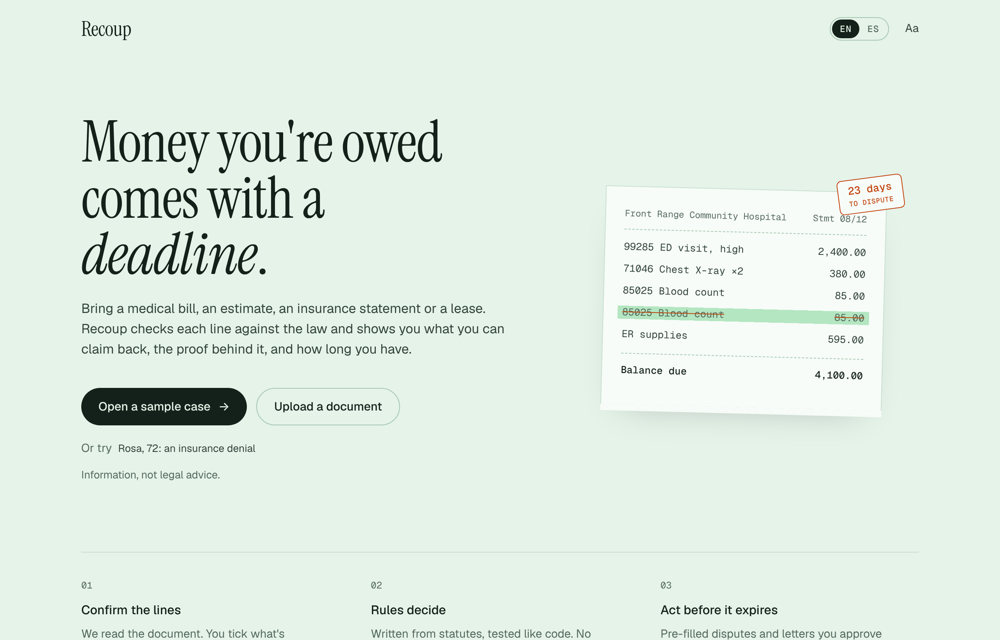
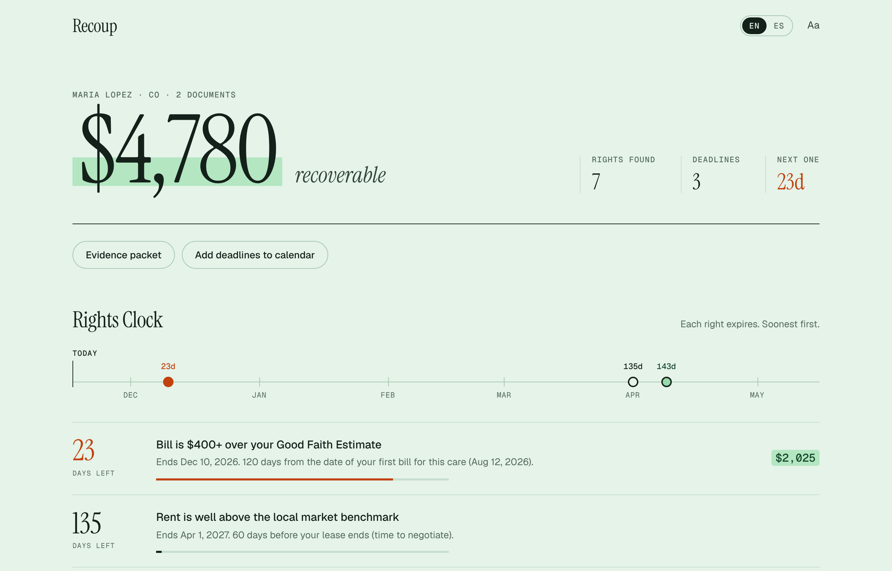
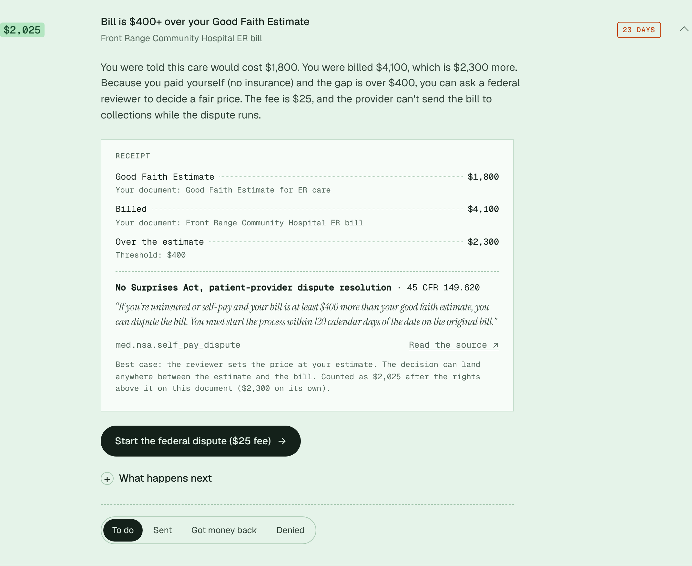
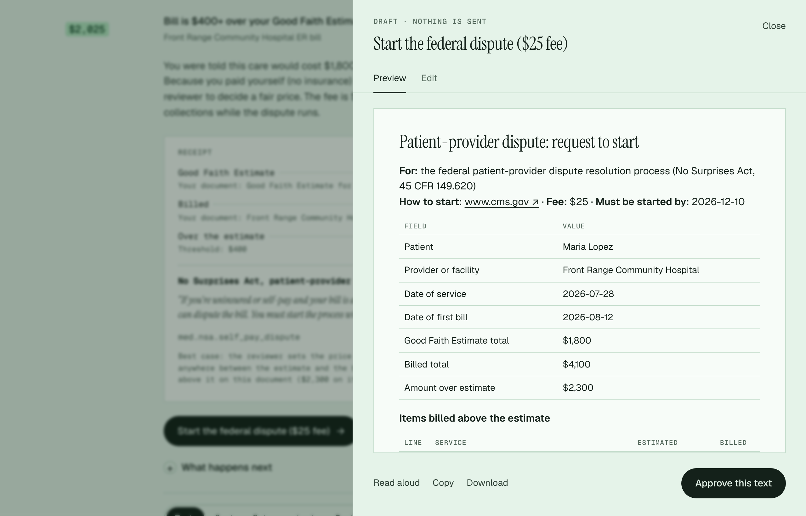

# Recoup

**Your money-back rights, with receipts and deadlines.**

Recoup reads a hospital bill, a Good Faith Estimate, an insurance statement or a lease, and turns them into one number ("$4,780 recoverable") and a **Rights Clock**: every right you have to get money back, with the date it expires. Every finding carries its receipts: the exact line on your document, the law it rests on, and the benchmark it was compared to.

Built for the IBM SkillsBuild AI Builders Challenge (AI for Good), with IBM Bob as the primary development tool.

> Recoup gives information, not legal advice. It never calls itself a lawyer.



## What it does

| | |
|---|---|
|  | **Rights Clock.** One honest total and every deadline on a timeline, soonest first. |
|  | **Receipts.** Each finding shows the bill line, the numbers compared, the law's own words and a source link. |
|  | **Approve the exact text.** Pre-filled federal dispute, aid request, Colorado demand letter or insurance appeal. Nothing is sent for you. |

Also in the app:

- **Confirm every line** before any rule runs, plus an "About you" panel (state, household, income) for aid screening
- **Progress tracker:** mark rights as sent, won or denied; follow-up dates; a running "Recovered" total
- **What happens next:** plain steps under each finding
- **Evidence packet:** every right in deadline order, printable or saved as PDF, for a caseworker or family member
- **Calendar file** with every deadline and a 7-day warning
- **English and Spanish**, larger text, read aloud, keyboard and screen-reader support
- **"How Recoup decides"** page that lists every rule pack and marks which data tables are still demo data

## Why

- Only 29% of patients who qualify for hospital financial assistance receive it.
- Money-back rights expire: 120 days to start a federal medical-bill dispute, 240 days to apply for hospital aid, 180 days to appeal an insurance denial.
- Existing tools find billing errors. None tells you which rights you have and when they die.

## How it works

```
upload  ->  Docling reads the file  ->  Granite extracts lines  ->  you confirm each line
        ->  rule packs decide (coded rules, no AI)  ->  Rights Clock + receipts
        ->  Granite rewrites explanations in plain words (numbers checked)
        ->  you approve a pre-filled dispute, letter or appeal word for word
```

**The AI explains; coded rules decide.** A finding can only come from a rule file. If no rule matches, Recoup says so instead of guessing. When Granite rewrites an explanation, Recoup checks that every number survived; if not, it shows the original template text.

## Rule packs

| Pack | File | Rules |
|---|---|---|
| Medical bills (US federal) | `recoup/packs/medical/us_federal.yaml` | No Surprises Act self-pay dispute ($400+ over estimate, 120 days); duplicate charges; CMS unit limits (MUE); 501(r) hospital financial assistance incl. refunds of paid bills (240 days); insurance denial appeal (180 days) |
| Rentals (Colorado) | `recoup/packs/rentals/co.yaml` | HB25-1090 banned fees (property-tax and common-area pass-throughs, processing fees) with 14-day demand and 18% interest; HUD Fair Market Rent benchmark |

A rule is a few lines of YAML: the check to run, its numbers, its citation, its deadline and the action it offers. Adding a state means adding a file. See `BOB.md`.

### Adding rights up honestly

Several rights can cover the same dollars. Recoup applies them in the order they'd play out (fix billing errors, then the dispute caps the price, then aid takes a percent off the rest), so the total never exceeds what you were charged. See `stack_rights` in `recoup/engine/evaluator.py`.

## Run it

```bash
pip install -r requirements.txt
uvicorn recoup.api:app --reload
# open http://localhost:8000 and click "Try the demo"
pytest -q
```

AI is off by default so the demo runs anywhere. To use IBM Granite, copy `.env.example` to `.env` and set `RECOUP_LLM=watsonx` (watsonx.ai) or `RECOUP_LLM=ollama` (local Granite). To read PDFs and photos, `pip install docling`.

## Project layout

```
recoup/
  models.py            Document, Case, Finding, Deadline, Report
  engine/
    packs.py           loads and validates rule pack YAML
    checks.py          the coded checks (one function per kind of rule)
    evaluator.py       runs rules, computes deadlines, stacks rights
  packs/               rule packs (YAML)
  data/                benchmark tables (demo subsets, see each file's _status)
  ai/granite.py        IBM Granite via watsonx.ai or Ollama; explain + extract
  intake/              Docling + Granite: file -> Document
  actions/             drafts: federal dispute, aid request, demand letter, appeal
  api.py               FastAPI app (analyze, draft, packet, calendar, sources)
web/                   no-build front end (large text, read aloud)
samples/               synthetic demo personas (Maria, Rosa)
tests/
```

## Demo data

All people, hospitals and landlords in `samples/` are made up. Tables in `recoup/data/` marked `DEMO` must be replaced with the real CMS, HHS and HUD data before any claim about accuracy (tracked in `BOB.md`).

## How we used Bob

_Fill in as you go: screenshots of each Bob session, and the count of rules and tests Bob wrote._

| Area | What Bob did | Evidence |
|---|---|---|
| Rule packs | | |
| Second state | | |
| Real CMS / HUD / HHS data | | |
| Intake (Docling + Granite) | | |
| Evaluation harness | | |
| AI phone call | | |

## Accuracy

_To be filled by the evaluation harness (`BOB.md`, task 5): planted violations caught and false flags on the seeded test set._
